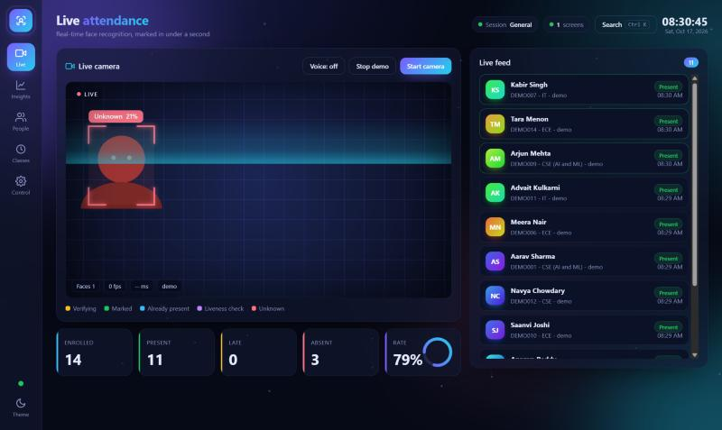
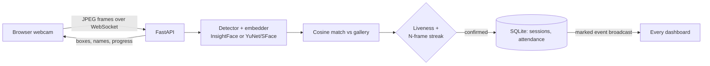

# FaceAttend AI - Face Recognition Attendance System


-orange)


> A real-time attendance system that recognises students from a webcam stream, marks them in under a
> second, and shows everything on a live, animated dashboard.



## Highlights

**Recognition**
- **Two interchangeable engines** - InsightFace ArcFace (512-d, most accurate) or OpenCV YuNet + SFace
  (128-d, installs with a plain `pip install`, models auto-download). `BACKEND=auto` picks the best available.
- **Multi-frame confirmation** - a student must be recognised in N consecutive frames before being marked.
- **Motion liveness check** - optional; requires natural head movement, so a photo held still is rejected.
- **Duplicate-face guard** - enrolling someone who already matches an existing student is refused.
- **Outlier filtering** - enrollment drops tiny/blurry faces and shots that do not resemble the rest.

**Attendance logic**
- **Class sessions** - start "Maths" or "Lab", set a *late after N minutes* rule, end the class to pause marking.
- **Present / Late / Absent** status, one mark per student per session (database `UNIQUE` constraint).
- **Manual override** - mark present or absent from the People screen; every action is audit-logged.
- **Multi-camera, multi-screen** - name each camera; marks appear on every open dashboard instantly.
- **Absentee alerts** - e-mail guardians (SMTP) or run as a dry run.
- **Admin login** - set `ADMIN_PASSWORD` to protect enroll, delete, settings and other write actions.

**Animated live UI**
- Glass-morphism dashboard with an ambient particle network, floating gradient orbs, dark/light themes.
- Face boxes **glide** between frames, with corner brackets, a scanning sweep, a verification progress bar,
  a success ripple and confetti burst.
- **Welcome banner** with an animated checkmark, optional voice greeting and sound chime.
- Count-up stats, an animated attendance ring, slide-in live feed cards.
- **Insights**: weekly and hourly charts, 12-week heatmap, department bars, at-risk list, punctuality ranking.
- **Guided enrollment** - oval face guide, countdown, camera-flash capture and pose prompts.
- **Demo mode** - runs the whole live UI with simulated people, no webcam needed.
- Command palette (`Ctrl K`), number-key navigation, calm mode, `prefers-reduced-motion` support, mobile layout.

## Architecture



## Quick start

```bash
git clone https://github.com/ruchirachowdary-1836/FaceAttend-AI.git
cd FaceAttend-AI
python -m venv venv
# Windows: venv\Scripts\activate      macOS/Linux: source venv/bin/activate
pip install -r requirements.txt
uvicorn app.main:app --reload
```

Open **http://localhost:8000**. Click **Demo mode** to explore without a camera, or **Start camera** and
**Enroll student**. The ~39 MB OpenCV models download on first start.

Want ArcFace accuracy? `pip install -r requirements-insightface.txt` (needs C++ build tools on Windows).
With `BACKEND=auto` it is used automatically when installed.

> Camera access requires `localhost` or HTTPS. For other devices use Uvicorn with `--ssl-keyfile/--ssl-certfile`.

### Docker

```bash
docker compose up --build        # http://localhost:8000, data and models persist in volumes
```

## Configuration

Environment variables (see [.env.example](.env.example)); recognition values can also be changed live in **Control**.

| Variable            | Default       | Meaning                                                       |
|---------------------|---------------|---------------------------------------------------------------|
| `BACKEND`           | `auto`        | `auto`, `opencv` or `insightface`                              |
| `MATCH_THRESHOLD`   | backend-based | Cosine cut-off (opencv 0.363, insightface 0.45). Higher = stricter |
| `CONFIRM_FRAMES`    | `3`           | Consecutive frames needed before marking                       |
| `LIVENESS`          | `off`         | `on` requires head movement before marking                     |
| `ADMIN_PASSWORD`    | empty         | Set to require login for all write actions                     |
| `SECRET_KEY`        | random        | Token signing key; set a fixed value for multi-worker deployments |
| `ATTENDANCE_TARGET` | `75`          | % below which a student appears under "At risk"                |
| `SMTP_*`            | empty         | Host, port, user, password, from-address for absentee alerts   |
| `DATA_DIR`, `MODELS_DIR`, `DB_PATH` | project folders | Storage locations                                 |

## API

Interactive docs at `/docs`. Write routes need `Authorization: Bearer <token>` from `POST /api/login` when `ADMIN_PASSWORD` is set.

| Method | Endpoint | Description |
|--------|----------|-------------|
| WS | `/ws/live?camera=Name` | Send JPEG bytes; receive `frame`, `marked`, `unknown`, `session`, `presence`, `roster` events |
| POST | `/api/students` | Enroll (form: roll_no, name, department, guardian_email, images[]) |
| POST | `/api/students/{id}/samples` | Add more face samples |
| GET / DELETE | `/api/students`, `/api/students/{id}` | List with attendance %, remove with all face data |
| POST | `/api/attendance/manual` | Manual present/absent for the active session |
| GET | `/api/attendance`, `/api/stats`, `/api/heatmap`, `/api/insights`, `/api/events` | Reads for the dashboard |
| GET / POST | `/api/sessions`, `/api/sessions/{id}/end` | Class sessions |
| GET / PATCH | `/api/config` | Read or change threshold, confirm frames, liveness |
| GET | `/api/export`, `/api/export/range?start=&end=` | CSV (formula-injection safe) |
| POST | `/api/notify/absentees` | E-mail guardians of absent students |
| POST / DELETE | `/api/demo/seed`, `/api/demo` | Fictional students with 5 weeks of history |

## Project structure

```
app/
  main.py         FastAPI app, WebSocket pipeline, REST routes
  recognizer.py   Backends (InsightFace / OpenCV), cosine matching
  liveness.py     Landmark-based head-movement check
  database.py     SQLite schema, queries, analytics, demo data
  auth.py         HMAC bearer tokens          notify.py   Absentee e-mails
  config.py       Settings
  static/         index.html, style.css, app.js (no build step)
tests/            15 pytest tests using a fake face backend
Dockerfile, docker-compose.yml, .github/workflows/ci.yml
```

## Testing

```bash
pip install -r requirements-dev.txt
python -m pytest -q
```

Tests use a fake face backend, so they need no camera or model download. They cover enrollment,
duplicate detection, the live WebSocket pipeline, liveness, sessions and late status, manual overrides,
stats, exports, alerts, settings and admin auth.

## Tips for best accuracy

1. Enroll in the lighting the classroom has; follow all five pose prompts.
2. Mount the camera at eye level, 1 to 2 metres from the entrance.
3. Raise the threshold if different people get confused; lower it if real students are missed.
4. Add samples with the **+ Face** button after glasses or hairstyle changes.
5. Use `BACKEND=insightface` for the best accuracy, `DET_SIZE=480` or a GPU provider for speed.

## Limitations (please read)

- The liveness check is a lightweight head-movement heuristic. It stops casual photo/screen replays but is
  **not** a trained anti-spoofing model and will not stop a determined attacker.
- Accuracy depends on lighting, camera and the people enrolled; measure FAR/FRR on your own classmates
  before relying on it, and keep a manual fallback.
- The recognition pipeline is covered by tests with a fake backend, and the OpenCV models were loaded and run
  on blank frames. It has not been benchmarked on real faces, so tune the threshold in your own classroom.

## Privacy and ethics

Face data is biometric personal data. Collect explicit consent, tell students what is stored and for how long,
and follow your institution's policy and local data-protection law. Only numeric embeddings are stored (no photos),
the **Delete** button removes a student with all their face data, and `ADMIN_PASSWORD` should be set for any
real deployment. Test across skin tones, genders and lighting for bias.

## Roadmap

- [ ] Trained anti-spoofing model (texture / depth)
- [ ] PostgreSQL option and per-camera zone rules
- [ ] WhatsApp alerts, timetable import
- [ ] Mask / low-light robustness

## License

MIT - free to use for learning and academic projects.
